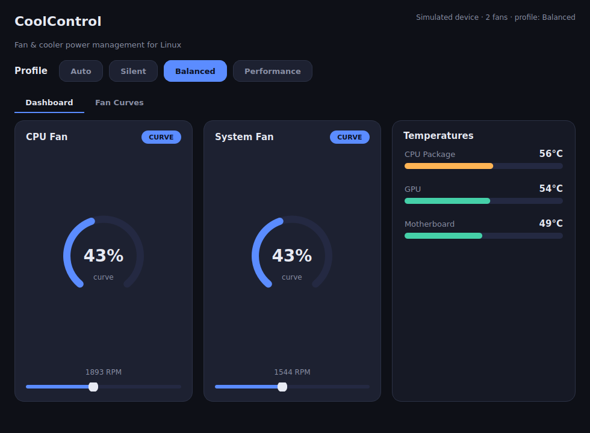
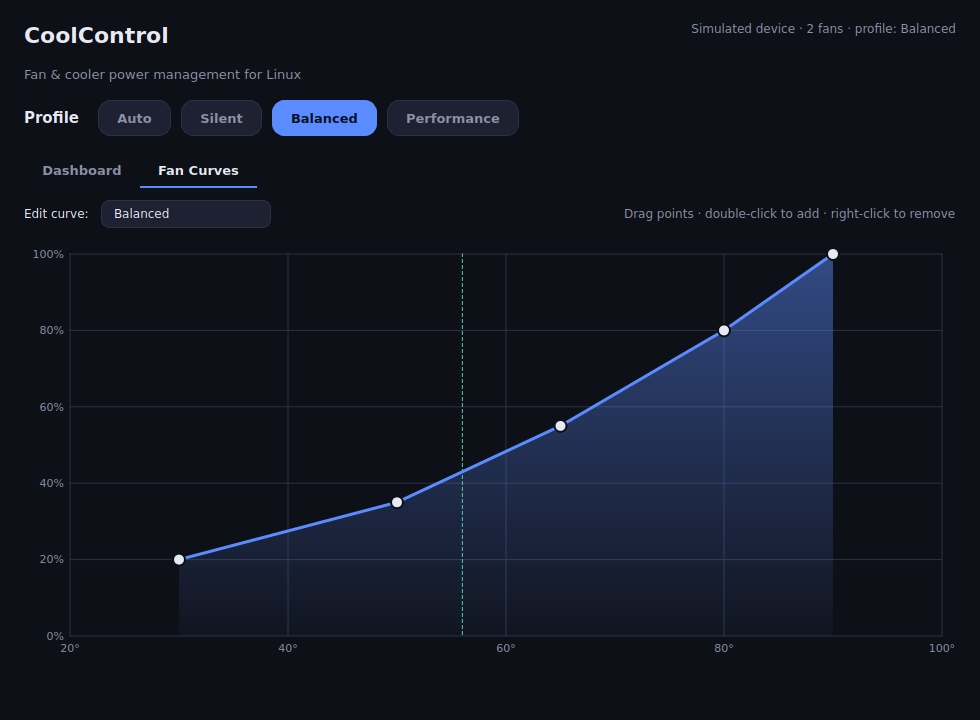

# CoolControl

**A fan & cooler power manager for Linux — written in C++ (Qt 6).**
Управление мощностью кулеров для Linux. 🇷🇺 **Русская инструкция:
[docs/README.ru.md](docs/README.ru.md).**

CoolControl reads your fans, temperatures and PWM outputs straight from the
Linux `hwmon` subsystem and lets you control cooler power by hand, with
one-click profiles, or with a custom temperature → speed curve.





> The images above are real, unretouched renders produced headlessly by
> `coolcontrol --screenshot <dir>`.

## Download

Grab a ready-to-run build from the
[**Releases page**](https://github.com/ismailpocta5-ctrl/code_for_me/releases):

```bash
chmod +x CoolControl-x86_64.AppImage
./CoolControl-x86_64.AppImage          # or: pkexec ./CoolControl-x86_64.AppImage
```

The AppImage bundles Qt, so there is nothing else to install. See the
[Russian download guide](docs/README.ru.md) for step-by-step instructions and
alternatives.

## Features

- **Live dashboard** — circular gauges per fan, RPM readouts, colour-shifting
  temperature bars.
- **One-click profiles** — `Auto` (firmware control), `Silent`, `Balanced`,
  `Performance`.
- **Interactive fan curves** — drag points, double-click to add, right-click to
  remove; applied live.
- **Manual override** — grab a slider to pin a fan at any speed.
- **Runs anywhere** — with no controllable hardware it falls back to a built-in
  **simulated device** (`coolcontrol --demo`).
- **CLI included** — `coolcontrol-cli` for headless boxes and scripts.
- **Safe by default** — hands every channel back to firmware on exit.

## Build from source

```bash
sudo apt install -y build-essential cmake ninja-build qt6-base-dev libgl1-mesa-dev
cmake -S . -B build -DCMAKE_BUILD_TYPE=Release
cmake --build build
./build/coolcontrol --demo
```

Run the tests with `ctest --test-dir build`. Package an AppImage with
`bash packaging/build-appimage.sh`.

## How it works

On Linux, fans and sensors live as small text files under
`/sys/class/hwmon/hwmonN/`:

| File            | Meaning                                   |
| --------------- | ----------------------------------------- |
| `fan1_input`    | fan speed in RPM (read-only)              |
| `temp1_input`   | temperature in milli-°C (read-only)       |
| `pwm1`          | fan duty cycle, `0`–`255` (read/write)    |
| `pwm1_enable`   | `0` full speed, `1` manual, `2` automatic |

CoolControl wraps these behind a small backend interface (`src/hwmon.*`). The
real `SysfsBackend` talks to `/sys`; the `SimulatedBackend` mimics a two-fan
laptop in memory (with a thermal model), so the app is fully usable and
testable without hardware.

## Project layout

```
src/            core (models, hwmon, curve, controller, config) + gui/ (Qt widgets)
tests/          C++ unit tests (run via ctest)
packaging/      .desktop, udev rule, AppImage build script, icon
.github/        CI (build + test) and Release (AppImage) workflows
docs/           Russian documentation
```

## License

MIT — see [`LICENSE`](LICENSE).
